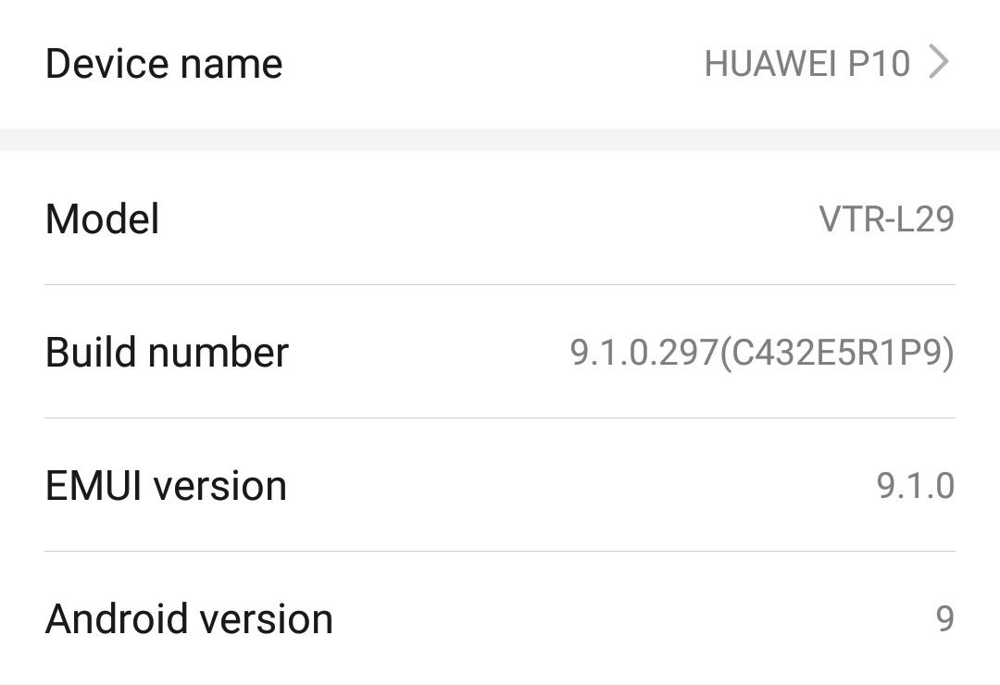
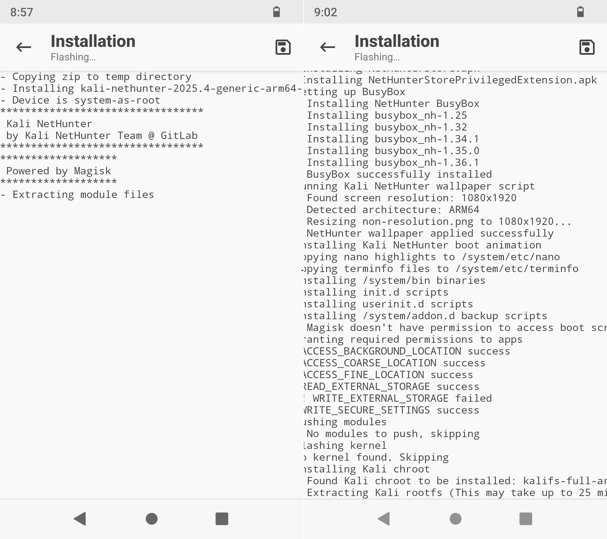

This tutorial assumes you already have an **unlocked bootloader**. If not, please check my previous tutorial on [how to install LineageOS on Huawei P10](/2024/01/02/how-to-install-lineage-os-19-on-huawei-p10.html).

You should also be running the **stock Huawei ROM**. If you aren't, restore it using EMUI recovery: hold **Volume Up** for 3 seconds during boot and follow the menu to download and install the original software via the internet.



## Install Lineage 19

Follow my previous tutorial, but ensure you choose the **bvN** version of LineageOS:

```bash
fastboot flash system lineage-19.1-20250606-UNOFFICIAL-arm64_bvN.img
fastboot reboot
```

**Important:** You must wipe data/factory reset the phone after the system partition is updated.

## Extract the stock recovery_ramdisk image

You need to extract the original recovery image. Enable **Developer Options** and the **ADB Root** option in LineageOS, then connect your phone to your PC and run:

```powershell
adb root
adb shell
```

Once connected as root, extract the image using `dd`:

```bash
phhgsi_arm64_ab:/ # ls -l /dev/block/by-name/recovery_ramdisk
lrwxrwxrwx 1 root root 16 2026-02-28 20:40 /dev/block/by-name/recovery_ramdisk -> /dev/block/sdd37

dd if=/dev/block/sdd37 of=/sdcard/recovery_ramdisk.img
exit
```

Backup the image to your PC:

```bash
adb pull /sdcard/recovery_ramdisk.img ~/Desktop
```

## Install Magisk

Download [Magisk](https://github.com/topjohnwu/Magisk/releases) and install it to your phone:

```bash
adb install Magisk-v30.7.apk
```

If the `recovery_ramdisk.img` file isn't on your phone, push it using:

```bash
adb push recovery_ramdisk.img /sdcard/Download/
```

1. Open **Magisk** on your phone and select **Install**.
2. Under **Options**, select **Recovery mode**.
3. Under **Method**, choose **Select and patch file** and pick your `recovery_ramdisk.img`.
4. After patching, pull the new image to your PC:

```bash
adb pull /sdcard/Download/magisk_patched_*.img .
```

## Flash recovery_ramdisk

Put your phone in **Fastboot mode** and flash the patched recovery image:

```bash
fastboot flash recovery_ramdisk magisk_patched-30700_XgO5U.img
fastboot reboot
```

**To boot with root:** When the phone reboots, hold **Volume Up + Power** until the Huawei logo appears. The phone will boot normally but with Magisk (root) enabled.

## Install Kali NetHunter Mobile

1. Download the **kali-nethunter-2025.4-generic-arm64-full** version from [Kali.org](https://www.kali.org/get-kali/#kali-mobile) and copy the zip to your phone.
2. Open **Magisk** -> **Modules** -> **Install from storage** -> select the Kali zip file.



3. After installation, grant root permissions in **Magisk** -> **Superuser**.


Have fun!